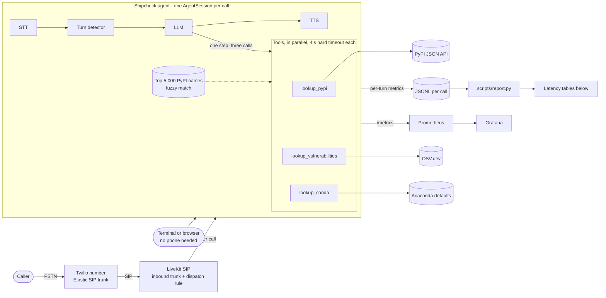

# Shipcheck

An inbound voice agent, built on [LiveKit Agents](https://docs.livekit.io/agents/) for Python.
A developer phones a number and asks whether a specific version of a Python package is safe
to ship. The agent answers from live data, verdict first: **ship**, **upgrade to X**, or **hold**.

It runs on a phone line (SIP), in your terminal, or in the browser, with the same code.

## Architecture



Speech-to-text, the LLM, text-to-speech and turn detection all run through
[LiveKit Inference](https://docs.livekit.io/agents/models/inference/), so the only credentials
are the three `LIVEKIT_*` values. Models are set in [`src/shipcheck/config.py`](src/shipcheck/config.py).

| File | What it holds |
| --- | --- |
| [`src/shipcheck/agent.py`](src/shipcheck/agent.py) | The agent: prompt, the four tools, silence handling, session wiring |
| [`src/shipcheck/names.py`](src/shipcheck/names.py) | Spoken name to PyPI project: normalisation, fuzzy match, spelling |
| [`src/shipcheck/upstreams.py`](src/shipcheck/upstreams.py) | PyPI, OSV and Anaconda clients with hard timeouts |
| [`src/shipcheck/turn_metrics.py`](src/shipcheck/turn_metrics.py) | Per-turn recorder: JSONL and Prometheus |
| [`scripts/report.py`](scripts/report.py) | Median and p95 from the JSONL; writes the tables in this README |
| [`scripts/measure.py`](scripts/measure.py) | Speaks scripted calls into the full audio pipeline to collect data |
| [`web/`](web/) | Browser page with a start/stop button and an audio-reactive blob, plus its local token server |
| [`telephony/`](telephony/) | Inbound trunk and dispatch rule as JSON, plus `setup.sh` |
| [`observability/`](observability/) | Prometheus and Grafana with docker compose |

### What a call does

1. Greets the caller and asks for a package and version.
2. Resolves the spoken name. Speech-to-text mangles names ("pie torch", "sci kit learn"), so
   the tools match what was heard against a local list of the 5,000 most-downloaded PyPI
   projects. A confident match is read back in the answer. A near miss ("polers") gets "did you
   mean polars?". No match falls back to asking the caller to spell it.
3. Calls three tools in one LLM step; they run concurrently.
   - **PyPI**: does the version exist, was it yanked, release dates, latest version.
   - **OSV**: vulnerabilities affecting that exact version and the first version that fixes all
     of them. That version is then checked against OSV again, so the agent does not recommend
     an upgrade target that has its own known vulnerabilities without saying so.
   - **Anaconda defaults**: which platforms have a build of that version.
4. Answers in two or three sentences, verdict first. No lists, and no CVE ids unless asked.
5. Handles follow-ups from the results it already has ("what about aarch64?"), interruptions
   (the framework's default barge-in), and silence (one nudge after 10 s, then a goodbye and
   hang-up).

### How it avoids inventing things

- A tool never raises on upstream trouble. A timeout, HTTP error or malformed payload becomes
  `{"status": "unavailable"}` with an instruction not to fill the gap, and the prompt makes
  "vulnerability source unavailable" a **hold**, never a ship.
- Version strings are validated before any request. OSV matches loosely on unparseable
  versions, so one is never sent.
- A package name is only ever a project from the local list or a name the caller spelled out,
  and PyPI then confirms it exists.
- The upgrade target is computed in code from OSV's `fixed` events, not chosen by the model.

## Run it without a phone

Requirements: [uv](https://docs.astral.sh/uv/), the [LiveKit CLI](https://docs.livekit.io/reference/developer-tools/livekit-cli/)
(`lk`), and a LiveKit Cloud project.

```shell
uv sync
lk cloud auth          # sign in and pick a project
lk app env -w          # writes LIVEKIT_URL, LIVEKIT_API_KEY, LIVEKIT_API_SECRET to .env.local
```

Then any of:

```shell
lk agent console           # talk to it in the terminal with your mic and speakers
lk agent console --text    # type instead of speaking
lk agent dev               # run it against LiveKit Cloud, then open the Agent Console link it prints
```

`uv run src/agent.py console` does the same as `lk agent console` if you prefer not to use `lk`.

### In the browser

[`web/`](web/) is a one-page frontend: a single button and a blob that moves with the audio,
blue while you talk and green while the agent replies.

```shell
uv run src/agent.py dev    # terminal 1: the agent
uv run web/server.py       # terminal 2: then open http://localhost:8000
```

`web/server.py` serves the page and, when you press start, signs a token for a new room with
the `shipcheck` agent dispatched into it, using the `LIVEKIT_*` values in `.env.local`. It
listens on 127.0.0.1 only, because anyone who can reach it can start a session on your project.
Pressing stop, closing the tab or the agent hanging up all end the session.

Open <http://localhost:8000/?preview> to see the page without connecting anything. It plays a
scripted conversation with simulated audio levels and uses neither the microphone nor LiveKit.

There is no build step: the page loads three.js and `livekit-client` from jsDelivr, pinned to
exact versions.

## Demo call script

About 75 seconds. Lines marked **You** are what to say.

> **Agent:** Shipcheck here. Which Python package and version are you thinking of shipping?
>
> **You:** Is requests two point one nine point zero safe to ship?
>
> **Agent:** *(upgrade verdict, the number of known vulnerabilities and the highest severity)*
>
> **You:** Is that version on conda for Linux on ARM?
>
> **Agent:** *(answers from the lookup it already did; no new lookup)*
>
> **You:** Okay, what about pie torch two point five point one?
>
> **Agent:** *(resolves "pie torch" to torch; hold verdict, because some of its vulnerabilities
> have no fixed version)*
>
> **You:** *(interrupt while it is talking)* What about aarch64?
>
> **Agent:** *(stops, then answers the platform question)*
>
> **You:** And polers one point zero?
>
> **Agent:** Did you mean polars?
>
> **You:** Yes.
>
> **Agent:** *(verdict for polars 1.0.0)*
>
> **You:** *(say nothing for ten seconds)*
>
> **Agent:** Are you still there? … *(ten more seconds)* … I haven't heard anything, so I'll
> hang up now. Goodbye.

Verdicts depend on live data, so the exact wording changes as packages publish fixes.

## Latency

Every number in this section was produced by [`scripts/report.py`](scripts/report.py) from
the per-turn JSONL files; none was typed by hand. Regenerate with:

```shell
uv run scripts/report.py --compare baseline tuned --write-readme
```

### How it is measured

Per turn, the agent records the framework's per-turn metrics from `ChatMessage.metrics`,
delivered by the `conversation_item_added` event (the session-level `metrics_collected` event
is deprecated and not used):

| Recorded | Source |
| --- | --- |
| End-of-turn delay | `end_of_turn_delay` on the user message |
| LLM time to first token | `llm_node_ttft` on each assistant message |
| TTS time to first byte | `tts_node_ttfb` on each assistant message |
| Tool duration | timed around each tool; the batch figure is first start to last end |
| Caller done to first agent audio | first assistant `started_speaking_at` minus user `stopped_speaking_at` |
| Caller done to start of answer | the same, for the last assistant message of the turn |

A turn is a **tool turn** if any tool ran, otherwise a **no-tool turn**. Turns go to
`data/turns/<date>-<job id>.jsonl` and to Prometheus histograms.

The data below comes from `scripts/measure.py`, which uses `lk agent debugger --audio` to
speak scripted caller lines into the agent's microphone input. Speech-to-text, turn
detection, the LLM, live PyPI/OSV/Anaconda lookups and text-to-speech all run for real. It
does not include the telephone network or SIP leg, so expect a phone call to add the carrier's
latency on top. The agent ran on a laptop in the UK, not in a LiveKit Cloud region.

### Results

<!-- latency:start -->
<!-- latency:end -->

### Tuning pass

<!-- tuning-notes -->

<!-- tuning:start -->
<!-- tuning:end -->

## Telephony

Inbound over SIP with Twilio Elastic SIP Trunking. The LiveKit side is two JSON files:

- [`telephony/inbound-trunk.json`](telephony/inbound-trunk.json): accepts calls to your number,
  with Krisp noise cancellation on.
- [`telephony/dispatch-rule.json`](telephony/dispatch-rule.json): puts each call in its own room
  and dispatches the `shipcheck` agent. It names rooms after the number that was dialled plus a
  random suffix, so the caller's own number does not end up in room names and logs.

```shell
# 1. Buy a number in the Twilio console. UK numbers need a regulatory bundle (proof of address).
# 2. LiveKit side, plus the Twilio trunk if the twilio CLI is installed and logged in:
SHIPCHECK_PHONE_NUMBER=+44XXXXXXXXXX telephony/setup.sh --twilio
#    Without --twilio it sets up LiveKit and prints the Twilio commands to run yourself.
telephony/setup.sh --status     # show what exists
```

The script is safe to re-run and never buys anything. The phone number is passed in from the
environment, not stored in the repo.

## Deploy to LiveKit Cloud

```shell
lk agent create      # first time: registers the agent, builds the Dockerfile, deploys
lk agent deploy      # later versions
lk agent logs
```

The [`Dockerfile`](Dockerfile) follows LiveKit's uv template. LiveKit Cloud injects the
`LIVEKIT_*` credentials at runtime, and no other secrets are needed. Container storage is
ephemeral, so on LiveKit Cloud the per-turn JSONL is best read from the logs (each turn is also
logged as one line by `shipcheck.metrics`) or shipped to object storage.

## Observability

```shell
# .env.local: SHIPCHECK_PROMETHEUS_PORT=9465
docker compose -f observability/docker-compose.yml up -d
# Grafana: http://localhost:3000   Prometheus: http://localhost:9090
```

The agent serves `/metrics` on the configured port using the framework's built-in Prometheus
endpoint in multiprocess mode, since each call runs in its own process. The dashboard
([`observability/grafana/dashboards/shipcheck.json`](observability/grafana/dashboards/shipcheck.json),
generated by `scripts/build_dashboard.py`) shows p50 and p95 for each stage split by tool and
no-tool turns, tool duration by upstream, upstream failures, and a tuning-profile selector.

## Tests

```shell
uv run pytest -m "not llm"    # offline: names, upstream clients, metrics, report, web token
uv run pytest -m llm          # agent behaviour; needs LIVEKIT_API_KEY and LIVEKIT_API_SECRET
```

The agent tests use LiveKit's testing helpers in text mode (`AgentSession.run()` and the
`expect` assertions, with `judge()` for wording). The LLM is real; PyPI, OSV and Anaconda are
replaced by a local fake server, so no test touches them. They cover:

- **Tool calls**: the three lookups are issued in one step and run concurrently; follow-ups
  reuse results without new requests.
- **Name resolution**: mangled names, near misses that must be read back, the spelling
  fallback, a missing version.
- **Upstream failure**: vulnerability source down means hold; a slow upstream hits the hard
  timeout; everything down still produces a spoken answer.
- **Refusing to guess**: a version that was never published, a request to answer from memory,
  a question the tools cannot answer.

[`ci.yml`](.github/workflows/ci.yml) runs lint and the offline tests on every push, and the
agent tests when the `LIVEKIT_*` repository secrets are set.

## What I would change for a production customer

This is a working demo. For a customer taking real calls I would change these, roughly in
order of how soon they would hurt:

- **Make the verdict deterministic.** The model currently applies the ship / upgrade / hold
  rules from the prompt. The tests show it does, but a rule table in code that hands the model
  a finished verdict to phrase would remove the last place it can get the decision wrong.
- **Replace the Anaconda source.** `api.anaconda.org/release/...` is the endpoint Anaconda's own
  client uses, but it has no public reference page and no stated limits. The documented source
  is the channel repodata at `repo.anaconda.com/pkgs/main`, which is 15 MB or more per platform
  and too slow per call. I would index it into a small store on a schedule and query that, which
  also gives "which versions *are* on defaults" (unknown today). Commercial use of the defaults
  channel is subject to Anaconda's terms of service, which need checking for the customer.
- **Cache and be a good citizen upstream.** A short TTL cache in front of all three sources
  (shared, for example Redis), a `User-Agent` with contact details as PyPI asks, ETag
  revalidation, and a circuit breaker so a failing upstream stops being called for a while.
- **Model failover.** Configure fallback models for STT, LLM and TTS, and a pre-recorded
  apology for when speech synthesis itself is down. Today a model outage ends the call.
- **Cover more than the top 5,000 names.** Refresh the list on a schedule, add the customer's
  internal packages, and feed the names to the STT as key terms so fewer arrive mangled.
- **Scope what "safe" means.** This checks known vulnerabilities in the package itself. A
  customer will want transitive dependencies (a lockfile or SBOM), their own policy (severity
  thresholds, allowed licences, minimum release age), and malware and typosquat feeds.
- **Measure on the real path.** The numbers above come from a laptop without the phone leg.
  I would deploy in the LiveKit Cloud region nearest the callers, pin the SIP region, measure
  with real calls, and alert on the p95 of caller-done-to-answer and on upstream failures.
- **Privacy and retention.** Transcripts are off in the JSONL by default; decide retention for
  LiveKit Cloud's own session recordings and traces, turn on PII redaction, and use the EU
  inference endpoints and region restriction for UK and EU callers.
- **Abuse and cost controls.** Restrict the inbound trunk to the provider's addresses, cap call
  length, rate-limit by caller number, and set spend alerts on Inference and Twilio.
- **Evaluation in CI.** Add LiveKit's audio simulations for interruption and endpointing
  behaviour, which the text-mode tests cannot see, and run them before each deploy.

## Docs this was built from

Pinned to `livekit-agents==1.8.12`, the latest stable release when this was written
(2.0.0b1 was in beta).

LiveKit docs, starting from <https://docs.livekit.io/agents/llms.txt>:

- Agents: [voice AI quickstart](https://docs.livekit.io/agents/start/voice-ai/),
  [agent sessions](https://docs.livekit.io/agents/logic/sessions/) (silence handling),
  [function tools](https://docs.livekit.io/agents/logic/tools/definition/),
  [external data and RAG](https://docs.livekit.io/agents/logic/external-data/) (feedback while tools run),
  [turn-taking tuning](https://docs.livekit.io/agents/logic/turns/tuning/),
  [turn handling options](https://docs.livekit.io/reference/agents/turn-handling-options/),
  [server startup modes](https://docs.livekit.io/agents/server/startup-modes/),
  [LiveKit Inference](https://docs.livekit.io/agents/models/inference/),
  [WarmTransferTask](https://docs.livekit.io/agents/prebuilt/tasks/warm-transfer/).
- Measurement and tests: [data hooks](https://docs.livekit.io/testing/observability/data/) (per-turn latency),
  [events reference](https://docs.livekit.io/reference/agents/events/),
  [unit tests](https://docs.livekit.io/testing/unit-tests/),
  [CLI agent debugger](https://docs.livekit.io/testing/debugger/).
- Telephony: [SIP trunk setup](https://docs.livekit.io/telephony/start/sip-trunk-setup/),
  [Twilio](https://docs.livekit.io/telephony/start/providers/twilio/),
  [inbound trunk](https://docs.livekit.io/telephony/accepting-calls/inbound-trunk/),
  [dispatch rule](https://docs.livekit.io/telephony/accepting-calls/dispatch-rule/).
- Deploy: [builds and Dockerfiles](https://docs.livekit.io/deploy/agents/builds/).
- Release notes: [livekit-agents 1.8.12](https://github.com/livekit/agents/releases/tag/livekit-agents%401.8.12)
  and [1.8.0](https://github.com/livekit/agents/releases/tag/livekit-agents%401.8.0).

Two things came from the installed 1.8.12 source rather than the docs: `RunContext.with_filler`
(the spoken "checking" line) and the `prometheus_port` server option.

Upstream APIs: [PyPI JSON API](https://docs.pypi.org/api/json/),
[OSV query API](https://google.github.io/osv.dev/post-v1-query/) and
[schema](https://ossf.github.io/osv-schema/),
[Anaconda default channels](https://www.anaconda.com/docs/getting-started/working-with-conda/reference/default-channels).
